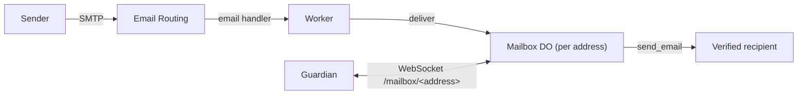

# cf-email-gateway

A Cloudflare Worker that connects Cloudflare Email Routing to the guardians of
AI agents. Deploy one instance per mail domain.

Each agent address gets its own SQLite-backed Durable Object, `Mailbox`
(`idFromName(address)`). The agent's guardian (`cf-email-unwrapper`) keeps a
WebSocket open to its Mailbox, receives inbound mail over it and sends replies
back through it. Agents themselves only speak A2A; the guardian does all
S/MIME and A2A work.



## What it does

- **Inbound** (`email` handler): reads the raw message Email Routing delivers
  and hands it to the Mailbox of the lowercased recipient address, which
  stores it and pushes it to the connected guardian, if any. If the Mailbox
  cannot take the message, the SMTP transaction is rejected with "Mailbox
  temporarily unavailable".
- **Guardian connection** (`fetch` handler, `GET /mailbox/<address>`): verifies
  the guardian's certificate signature and forwards the WebSocket upgrade to the Mailbox. On every new
  connection the Mailbox sends all stored mail, oldest first.
- **Outbound**: the guardian sends a finished reply over the WebSocket; the
  Mailbox sends it unchanged through the `send_email` binding, with the
  mailbox address as envelope sender.

## What it does not do

- No S/MIME on mail: it never decrypts, signs, encrypts or verifies mail and
  holds no private keys or secrets. The only cryptography is the check of the
  guardian's connection signature against the public CA certificate.
- No sender or signature checks. Email Routing only routes whitelisted agent
  addresses to this Worker; everything else is checked by the guardian.
- No agent logic and no message parsing.

## Contract

### Connection

```
GET /mailbox/<address>
Upgrade: websocket
X-Mailbox-Signature: <base64 DER CMS SignedData>
```

`<address>` may be percent-encoded; the Worker trims and lowercases it.

The guardian proves that it owns the address with its bot signing key, whose
certificate is issued by the user's own CA. On every connection attempt it
makes a fresh detached CMS signature over the UTF-8 bytes

```
cf-email-gateway mailbox v1\n<address>\n
```

(`<address>` trimmed and lowercased, `\n` a line feed), with signed
attributes (signingTime included) and the signer certificate embedded, as
`openssl cms -sign` does by default:

```sh
printf 'cf-email-gateway mailbox v1\n%s\n' hermes@example.org >challenge
openssl cms -sign -binary -md sha256 -outform DER -in challenge \
  -signer bot-signing.crt.pem -inkey bot-signing.key.pem -out sig.der
base64 <sig.der | tr -d '\n'    # value of X-Mailbox-Signature
```

The Worker verifies it with PKI.js against the `CA_CERT` secret. All of these
must hold:

1. exactly one signer, and the signature verifies over the content above (the
   CMS must be detached);
2. the signer certificate chains to a certificate in `CA_CERT` and every
   certificate in the chain is within its validity period now;
3. the signer certificate has keyUsage `digitalSignature` and
   extendedKeyUsage `emailProtection`;
4. the address equals, case-insensitively, an rfc822Name in its
   subjectAltName or its subject emailAddress;
5. signingTime is present and at most 5 minutes from the Worker's clock.

A failed check is logged as `auth_failed` with the reason; the response body is
just `unauthorized`.

| Condition | Response |
| --- | --- |
| Path other than `/mailbox/<address>` | 404 |
| No `Upgrade: websocket` | 426 |
| `CA_CERT` not configured or not a PEM certificate | 500 |
| Missing or invalid signature | 401 |
| Otherwise | 101, WebSocket to the address's Mailbox |

Limitations:

- **No revocation.** The CA has no CRL or OCSP yet, so a leaked bot signing
  key stays usable until its certificate expires or the CA is replaced in
  `CA_CERT`.
- **Replay window.** A signature is valid for 5 minutes either side of its
  signingTime and is not bound to the connection; an attacker who captures one
  can reuse it within that window. Connections run over TLS only, so capture
  requires breaking TLS or the guardian host. A replayed connection would
  replace the guardian's socket and could receive and ack stored mail until
  the guardian reconnects with a fresh signature.

A Mailbox keeps one connection: accepting a new socket closes older ones with
code 4000, reason `replaced`. The guardian keeps the connection alive with
WebSocket protocol pings, which Cloudflare answers without waking the Durable
Object.

### Frames

A binary frame is a UTF-8 JSON header, `\n`, then raw bytes.

| Direction | Frame | Content |
| --- | --- | --- |
| Mailbox → guardian | binary | `{"type":"mail","id":"<uuid>","from":"<envelope from>","to":"<address>","receivedAt":"<ISO 8601>","size":<raw byte length>}` + raw `.eml` |
| guardian → Mailbox | text | `{"type":"ack","id":"<mail id>"}`: deletes the mail; unknown ids are ignored; no reply |
| guardian → Mailbox | binary | `{"type":"send","id":"<client-chosen id>","to":"<recipient>"}` + raw reply `.eml` |
| Mailbox → guardian | text | `{"type":"sent","id":"…","messageId":"<…>"}` (the Message-ID the recipient sees: Cloudflare replaces the header) or `{"type":"error","id":"…","message":"…"}` in answer to `send` |
| Mailbox → guardian | text | `{"type":"error","id":null,"message":"…"}` for an unparseable frame |

A reply is sent with `new EmailMessage(<address>, <to>, raw)`: envelope
sender is the mailbox address, envelope recipient the header's `to`. The
message's `From:` header must match the mailbox address and `to` must be a
verified destination address.

### Guarantees

- Delivery is at least once. Mail stays in the Mailbox until it is acked;
  unacked mail is resent on the next connection only (not while the same
  connection stays open). The guardian deduplicates by `Message-ID`.
- Mail is kept for at most 14 days: every delivery first deletes stored mail
  older than that.

### Logs

One JSON line per event: `received` (id, from, to, size) and `rejected`
(inbound); `sent` and `send_failed` (outbound); `push_failed` if a frame could
not be written to the connected socket (the mail stays stored); `auth_failed`
(address, reason) for a rejected guardian connection and `config_error` for
an unusable `CA_CERT`.

## Operator setup

1. **Deploy** once: `npm install && npx wrangler deploy`, or import this
   repository in **Workers & Pages → Create application → Import a
   repository** (Workers Builds; build command `npm run check && npm test`,
   deploy command `npx wrangler deploy`). The deployment creates the
   `Mailbox` Durable Object class; nothing else has to exist beforehand.
2. **Secret** `CA_CERT` (Worker → Settings → Variables and Secrets, type
   Secret, or `npx wrangler secret put CA_CERT < ca.crt.pem`): the PEM
   certificate of the CA that issues the guardians' bot signing certificates.
   Several PEM blocks are allowed (e.g. old and new CA during a rollover). The
   dashboard field may turn line breaks into spaces; such single-line PEM
   works too. It is public material, kept as a secret rather than a `[vars]`
   entry only so deployments do not reset it.
3. **Email Routing**: on the mail domain, add one custom address rule per
   agent address with the action "Send to a Worker" → `cf-email-gateway`. Do
   not use a catch-all rule.
4. **Recipients**: add every address that agents may reply to as a verified
   destination address in Email Routing; `send_email` only delivers to
   verified addresses.
5. **Guardian certificate** for an agent address: issue the guardian's bot
   signing certificate from that CA with keyUsage `digitalSignature`,
   extendedKeyUsage `emailProtection` and the agent address as
   subjectAltName `email:` (or subject emailAddress).
6. **Observability**: Workers Logs are enabled in `wrangler.toml`.

The previous transport's queues (`mail-*`, `email-outbox`,
`email-outbox-dlq`) and R2 bucket `email-agents` are no longer used and can be
deleted by hand, as can the old secrets `CF_ACCOUNT_ID`, `CF_API_TOKEN` and `GATEWAY_SECRET`.

## Limits and costs

- Email Routing caps inbound mail at 25 MiB. The Mailbox stores raw mail in
  1 MiB SQLite chunks, because a SQLite row is limited to 2 MB.
- A reply must fit into one WebSocket message, which Durable Objects accept up
  to 32 MiB.
- A connected guardian uses the WebSocket Hibernation API: an idle, hibernated
  Durable Object is not billed for duration, and protocol pings do not wake it.
  Costs come from requests (inbound mail, WebSocket messages) and SQLite
  storage of mail not yet acked.

## Development

```sh
nix develop      # optional: Node.js toolchain
npm install
npm run check    # tsc --noEmit
npm test         # vitest in the Workers runtime (@cloudflare/vitest-plugin)
```

The tests run the Worker and its Durable Object in a local workerd. Miniflare's
`send_email` binding stands in for Email Routing: it checks that the `From:`
header matches the envelope sender and only allows `author@example.com` as
recipient (see `vitest.config.ts`).

`test/fixtures/generate.sh` regenerates the test PKI (a test CA, a rogue CA,
the guardian key and one signature made with `openssl cms -sign`); the tests
issue per-address certificates from it and sign challenges with PKI.js.
